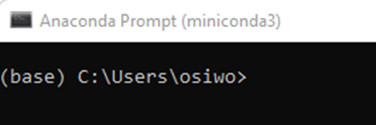
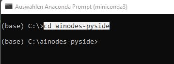

# aiNodes - Stable Diffusion Desktop

<p align="left">
<a href="https://github.com/XmYx/ainodes-pyside/commits"></a>
<a href="https://github.com/XmYx/ainodes-pyside/issues"></a>
<a href="https://github.com/XmYx/ainodes-pyside/stargazers"></a>
<a href="https://github.com/XmYx/ainodes-pyside/network"></a>
<a href="https://github.com/XmYx/ainodes-pyside/blob/main/aiNodes_webAPI_colab_v0_0_2_public.ipynb"></a>  
</p>

Please join our Discord for further information: https://discord.gg/XDQm9pk5pd
Support us on Patreon: https://www.patreon.com/ainodes
Welcome to aiNodes, a desktop GUI with Deforum Art, Outpaint, Upscalers, and many more.




## Install and run

You need **git** and either **[uv](https://docs.astral.sh/uv/)** (recommended, it also fetches the right
Python for you) or **Python 3.10 - 3.12**. An NVIDIA GPU is recommended; Apple Silicon runs on MPS and
anything else falls back to CPU.

```bash
git clone https://github.com/XmYx/ainodes-pyside
cd ainodes-pyside
./start.sh          # Linux and macOS
```

On Windows double-click `start.bat` (or run it from a terminal). Do not use admin rights.

The first start creates `.venv`, installs PyTorch (CUDA 12.8 build when `nvidia-smi` is found) and
everything in `requirements.txt`, and clones the helper repos (BLIP, MiDaS, taming, ...) into `src/`.
Later starts skip all of that unless `requirements.txt` changed. On the first launch the app also
downloads a few GB of support models (BLIP, MiDaS) into `data/models/support`.

| Option | What it does |
| --- | --- |
| `--install-only` | prepare the environment without starting the app |
| `--reinstall` | reinstall all dependencies |
| `--cpu` | install the CPU build of PyTorch |
| `--test` | run the unit tests (`pytest` arguments may follow) |

Set `AINODES_TORCH_INDEX` to use a different PyTorch wheel index (e.g. a ROCm one).
To update: `git pull`, then start as usual.

Put Stable Diffusion 1.x / 2.x checkpoints into `data/models`, or download them from the
Model Download tab.

## Generate with ComfyUI

aiNodes can hand txt2img jobs to a running [ComfyUI](https://github.com/comfyanonymous/ComfyUI) server
instead of its own models, which also gives you every checkpoint ComfyUI can load (SDXL and newer).
Open **System Settings**, tick **Generate with ComfyUI**, check the URL (default
`http://127.0.0.1:8188`) and optionally name a checkpoint; empty picks the first one ComfyUI lists.
The prompt box, negative prompt, size, steps, CFG, sampler, seed and batch settings are passed through,
one prompt per line. Results show on the canvas and are saved to the txt2img output folder.

## Development

```bash
./start.sh --test           # unit tests; the ComfyUI test runs only when a server is reachable
./start.sh --test -m "not slow"
```

`backend/compat.py` holds the shims that keep the bundled 2022/2023 model code working on current
torch, transformers and pytorch_lightning releases.

# F.A.Q:

1. Why do I get access denied when files are downloaded from Hugging Face into the user `.cache` folder?
Rename or delete the existing cache folder so a new one can be created, or set `HF_HOME`
to point to a different directory.
2. The app looks frozen.
Some modules download data the first time they are used and cannot report progress; check the
terminal for output before assuming it hangs.




# Feature List
- Deforum as render Backend
- Deforum like prompt weighting
- text to image
- image to image
- text to video
- video to video
- Automatic1111 like prompting

- seamless for render textures and stuff
- HiRes Render two phase Hires Rendering
- multidimensional Prompting allows to prompt settings with lists of values which then get looped, produces massive amounts of images with different settings
- multi Model Batch allows your prompt(s) to be rendered with different models in one single run. Just prepare run and go get coffee
- textual inversion 
- VAE
- hypernetworks
- karras
- plotting with XY axis enter a list of values to be used for different settings on X and Y axis to in the end get a grid image showing the results for easy compare
- plugins A list of plugins exists like training and webcam fun list will grow over time, and you're welcome to add your own plugins or a Colab API Server with limited functionality
- canvas for manual, batched in and outpaint as well as a Batch Hires image to image process
- model downloads in UI, just search civit AI for a new model, download it and directly start using it, no need to copy files or anything just stay in the tool
- image lab with many features most of them are bulk centered like
  - image to text which generates a ascii image of your image (It's there mainly for fun)
  - image crop helps you to crop your images for training
  - upscale use realesrgan and gfpgan to upscale and make nicer faces
  - watermark add visible watermarks to your image to prevent theft
  - interrogation make images to prompts with interrogation or clip interrogation
  - aesthetic prediction help to sort your large amounts of images based on aesthetic guess from an AI
  - merge models 1.x or 2.x
  - upscale 2.0 it's a SD 2.0 feature which is so hungry for VRam that it nearly makes no sense but we added it anyways
- search for prompts at lexica or kreas getting not only prompts but also sample images
- as well as search for prompts only text
  - use interrogation to get prompts from your holiday photos
  - use an AI to help make better prompts
- GPU infos about memory usage

All this is hiding behind that very harmless looking UI once you installed it and run it for the first time.

Click on show / hide options to enable the full power of this UI to help you make more art in less time


