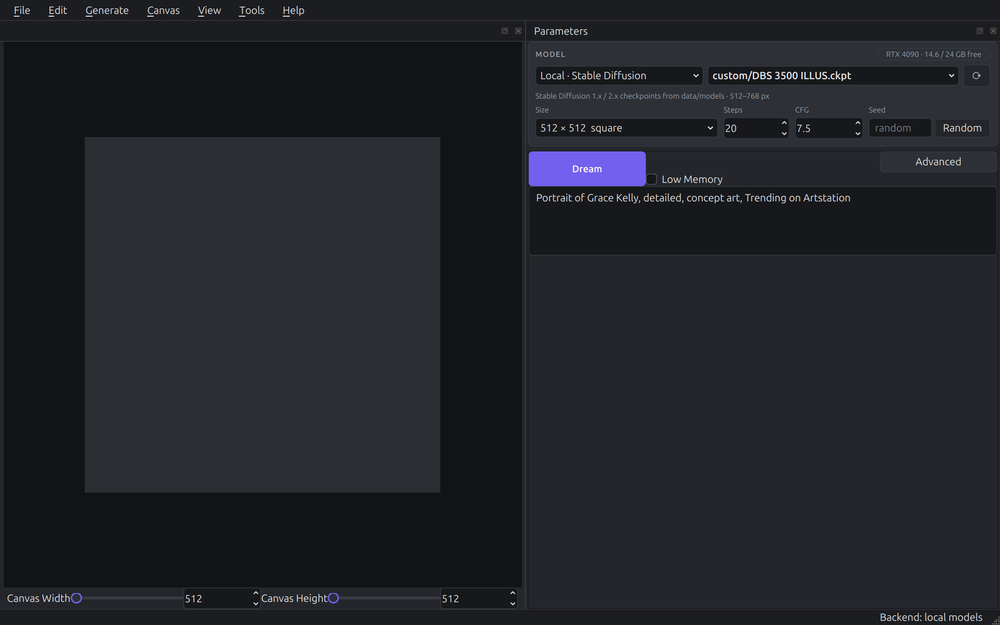
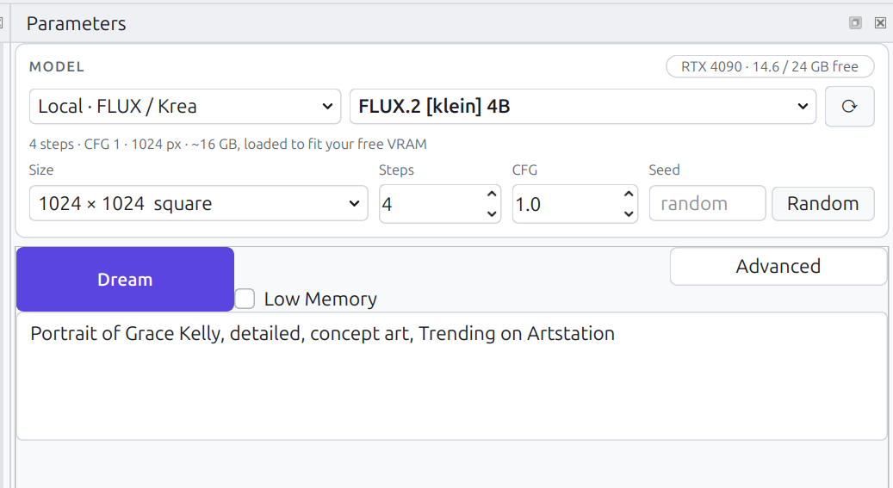
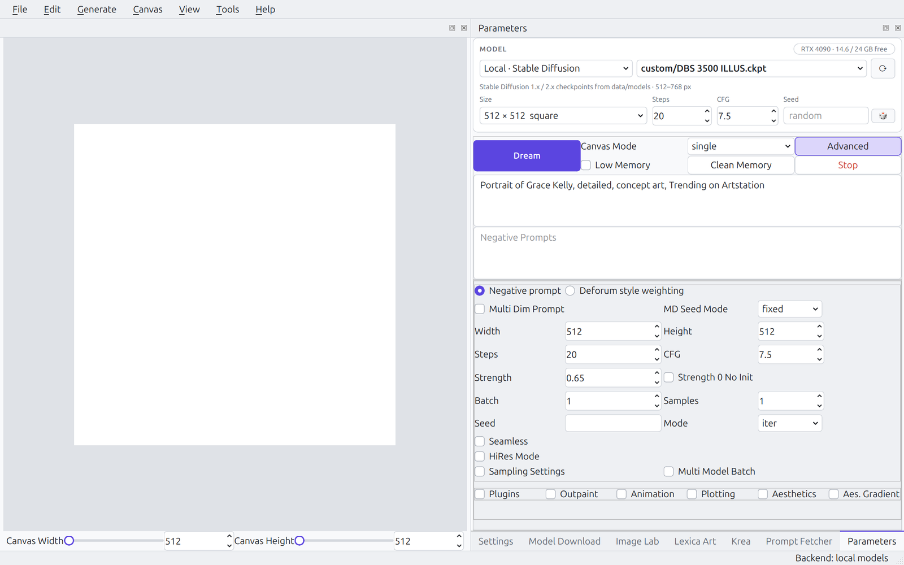

# aiNodes - AI Image Desktop

<p align="left">
<a href="https://github.com/XmYx/ainodes-pyside/commits"></a>
<a href="https://github.com/XmYx/ainodes-pyside/issues"></a>
<a href="https://github.com/XmYx/ainodes-pyside/stargazers"></a>
<a href="https://github.com/XmYx/ainodes-pyside/network"></a>
<a href="https://github.com/XmYx/ainodes-pyside/blob/main/aiNodes_webAPI_colab_v0_0_2_public.ipynb"></a>  
</p>

Please join our Discord for further information: https://discord.gg/XDQm9pk5pd
Support us on Patreon: https://www.patreon.com/ainodes

aiNodes is a desktop app for AI image making: text to image, an infinite canvas for inpainting and
outpainting, Deforum animation, upscalers and an image lab. It runs Stable Diffusion 1.x / 2.x and current
models such as **FLUX.2**, **FLUX.3** and **Krea 2** on your own GPU, or hands the work to a
**ComfyUI** server.



## What's new in 1.0

- **Model card**: backend, model, size, steps, CFG, seed and free GPU memory always in view.
- **Current models**: FLUX.2 [klein] / [dev], FLUX.3 [klein] and Krea 2, locally through diffusers or on
  ComfyUI, with each model's recommended settings applied when you pick it.
- **Uses the memory you actually have**: free VRAM is measured before every load; models go fully on the
  GPU, as fp8 weights, or swapped / streamed from RAM. NVIDIA, AMD (ROCm), Intel (XPU), Apple (MPS) and CPU.
- **Inpaint and outpaint that blend**: single tiles and whole canvas batches on every backend, without
  visible seams.
- **ComfyUI backend** for SD, SDXL and the modern model families, with fp8 and `torch.compile`.
- **New look**: light, dark and system themes, a full menu bar, simple and advanced modes.
- **One-step install**: `start.sh` / `start.bat` build the environment for your GPU and start the app.
- Ported to Python 3.12, PyTorch 2.11, transformers 5, diffusers 0.42 and PySide6 6.12; unit tests included.

## Install and run

You need **git** and either **[uv](https://docs.astral.sh/uv/)** (recommended, it also fetches the right
Python for you) or **Python 3.10 - 3.12**. An NVIDIA GPU is recommended; Apple Silicon runs on MPS and
anything else falls back to CPU.

```bash
git clone https://github.com/XmYx/ainodes-pyside
cd ainodes-pyside
./start.sh          # Linux and macOS
```

On Windows double-click `start.bat` (or run it from a terminal). Do not use admin rights.

The first start creates `.venv`, installs PyTorch (CUDA 12.8 build when `nvidia-smi` is found) and
everything in `requirements.txt`, and clones the helper repos (BLIP, MiDaS, taming, ...) into `src/`.
Later starts skip all of that unless `requirements.txt` changed. On the first launch the app also
downloads a few GB of support models (BLIP, MiDaS) into `data/models/support`.

| Option | What it does |
| --- | --- |
| `--install-only` | prepare the environment without starting the app |
| `--reinstall` | reinstall all dependencies |
| `--cpu` | install the CPU build of PyTorch |
| `--test` | run the unit tests (`pytest` arguments may follow) |

The launcher picks the PyTorch build for your GPU: CUDA for NVIDIA, ROCm for AMD on Linux, XPU for
Intel Arc / Xe, the standard build with Metal (MPS) on Apple Silicon, CPU otherwise. AMD on Windows has
no ROCm PyTorch wheels, so there it runs on CPU; use the ComfyUI backend for GPU speed. Set
`AINODES_TORCH_INDEX` to force another wheel index and `AINODES_DEVICE` (`cuda`, `xpu`, `mps`, `cpu`)
to force a device. *Help ▸ About* shows what was detected.
To update: `git pull`, then start as usual.

Put Stable Diffusion 1.x / 2.x checkpoints into `data/models`, or download them from the
Model Download tab.

## Using the app

aiNodes starts in **simple mode**: the model card, a prompt, the **Dream** button and the canvas.
The **model card** at the top of the parameter panel shows where images are generated (local Stable
Diffusion, a local FLUX / Krea model, or a ComfyUI server), the model, the image size, steps, CFG and seed,
and how much GPU memory is free right now. Picking a model sets the steps, CFG and size it was made for;
the hint line underneath names anything that is missing (a gated model's login, a ComfyUI VAE, ...).

<p align="center"></p>

Turn on
**Advanced** (the button in the parameter panel, *View ▸ Advanced Mode* or `Ctrl+Shift+A`) to show
every option and the extra panels (settings, model download, image lab, prompt tools); the choice
is remembered.

The menu bar holds the everyday functions: new canvas, open image, open/save canvas projects and
export the canvas as PNG (*File*); undo and delete (*Edit*); dream, stop, the ComfyUI switch and
model loading (*Generate*); canvas modes (*Canvas*); themes, panels and full screen (*View*).
*Help ▸ Keyboard Shortcuts* lists the shortcuts; `Ctrl+Enter` dreams from anywhere.



*View ▸ Theme* offers **Light**, **Dark** and **System**, which follows your desktop's light/dark
setting and switches along with it.

## Models and memory

Besides Stable Diffusion 1.x / 2.x, *Generate ▸ Native Model* runs current models in-process through
diffusers: **FLUX.2 [klein] 4B** (free download), and, after accepting their licenses on Hugging Face
and logging in with `huggingface-cli login`, **FLUX.2 [klein] 9B**, **FLUX.2 [dev]**, **Krea 2 Turbo** and
**FLUX.3 [klein]**. Weights download on first use.

Before loading, aiNodes measures the memory that is *actually free* on the GPU right now (other apps,
a running ComfyUI and the desktop count) and keeps a reserve. Depending on that it loads the model fully,
stores the weights as fp8 (half the memory, on any GPU except Apple), swaps components between GPU and
RAM, or streams the transformer block by block. *Compile Model* compiles the transformer's repeated blocks
with `torch.compile` where supported (NVIDIA, AMD ROCm, Intel XPU): the first image is slower, later ones
faster.

## Inpainting and outpainting

The canvas inpaints (paint over an area with the inpaint brush) and outpaints, one tile at a time or as a
batch (*Preview batch*, then *Run batch*), with every backend: the native SD 1.5 inpainting model, the
modern native models, and any ComfyUI model. For models that were not trained for inpainting the
area is pre-filled from its surroundings, generated with a feathered mask at the model's native resolution
and blended back with a second light pass over the seam; only the masked area changes.

| FLUX.2 [klein] 4B, local: canvas batch of 6 tiles (24 s on an RTX 4090) | Krea 2 on ComfyUI: same batch (91 s) |
| --- | --- |
|  |  |

| Text to image, FLUX.2 [klein] 4B (1024 px, 1.3 s) | Outpainting the right half of the scaled-down image |
| --- | --- |
|  |  |

## Generate with ComfyUI

aiNodes can hand txt2img jobs to a running [ComfyUI](https://github.com/comfyanonymous/ComfyUI) server
instead of its own models, which also gives you every checkpoint ComfyUI can load (SDXL and newer).
Tick *Generate ▸ Generate with ComfyUI* (or the same box in *Settings*), check the URL in *Settings* (default
`http://127.0.0.1:8188`) and optionally name a checkpoint; empty picks the first one ComfyUI lists.
The prompt box, negative prompt, size, steps, CFG, sampler, seed and batch settings are passed through,
one prompt per line. Results show on the canvas and are saved to the txt2img output folder.

*Generate ▸ ComfyUI Model* lists the image models on the server: SD / SDXL checkpoints and the modern
diffusion models **Krea 2**, **FLUX.2** and **FLUX.3**, for which aiNodes picks the matching text encoder
and VAE and the sampler settings from ComfyUI's official templates (distilled models keep their tuned
steps and CFG). If a part is missing, the status bar names it (e.g. `flux2-vae` for FLUX.2). On GPUs
with fp8 support, full-precision models load as fp8; *Compile Model* adds `TorchCompileModel`. FLUX.3
needs a ComfyUI from October 2026 or newer.

## Development

```bash
./start.sh --test           # unit tests; the ComfyUI test runs only when a server is reachable
./start.sh --test -m "not slow"
```

`backend/compat.py` holds the shims that keep the bundled 2022/2023 model code working on current
torch, transformers and pytorch_lightning releases.

# F.A.Q:

1. Why do I get access denied when files are downloaded from Hugging Face into the user `.cache` folder?
Rename or delete the existing cache folder so a new one can be created, or set `HF_HOME`
to point to a different directory.
2. The app looks frozen.
Some modules download data the first time they are used and cannot report progress; check the
terminal for output before assuming it hangs.

# Feature List
- current models: FLUX.2 [klein] / [dev], FLUX.3 [klein], Krea 2 (local through diffusers or on ComfyUI)
- ComfyUI backend for SD 1.x / 2.x, SDXL and the modern families, fp8 weights and torch.compile
- hardware detection and VRAM planning for NVIDIA, AMD, Intel, Apple and CPU
- model card with the essential settings, light / dark / system themes, menu bar, simple and advanced mode
- Deforum as render Backend
- Deforum like prompt weighting
- text to image
- image to image
- text to video
- video to video
- Automatic1111 like prompting

- seamless for render textures and stuff
- HiRes Render two phase Hires Rendering
- multidimensional Prompting allows to prompt settings with lists of values which then get looped, produces massive amounts of images with different settings
- multi Model Batch allows your prompt(s) to be rendered with different models in one single run. Just prepare run and go get coffee
- textual inversion 
- VAE
- hypernetworks
- karras
- plotting with XY axis enter a list of values to be used for different settings on X and Y axis to in the end get a grid image showing the results for easy compare
- plugins A list of plugins exists like training and webcam fun list will grow over time, and you're welcome to add your own plugins or a Colab API Server with limited functionality
- canvas for manual, batched in and outpaint as well as a Batch Hires image to image process
- model downloads in UI, just search civit AI for a new model, download it and directly start using it, no need to copy files or anything just stay in the tool
- image lab with many features most of them are bulk centered like
  - image to text which generates a ascii image of your image (It's there mainly for fun)
  - image crop helps you to crop your images for training
  - upscale use realesrgan and gfpgan to upscale and make nicer faces
  - watermark add visible watermarks to your image to prevent theft
  - interrogation make images to prompts with interrogation or clip interrogation
  - aesthetic prediction help to sort your large amounts of images based on aesthetic guess from an AI
  - merge models 1.x or 2.x
  - upscale 2.0 it's a SD 2.0 feature which is so hungry for VRam that it nearly makes no sense but we added it anyways
- search for prompts at lexica or kreas getting not only prompts but also sample images
- as well as search for prompts only text
  - use interrogation to get prompts from your holiday photos
  - use an AI to help make better prompts
- GPU infos about memory usage

All this is hiding behind that very harmless looking UI once you installed it and run it for the first time.

Turn on **Advanced** to enable the full power of this UI to help you make more art in less time.
